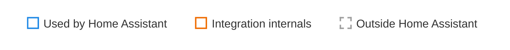
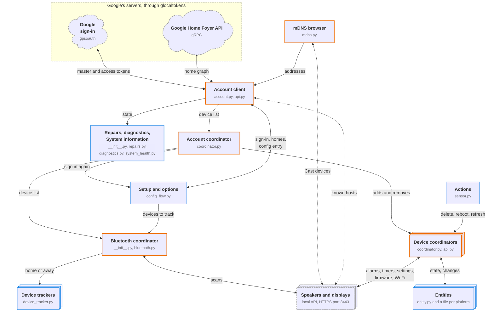

# Contributing

## Ask a question

For help with setup or usage, search the [issues](https://github.com/leikoilja/ha-google-home/issues?q=is%3Aissue). If nobody has asked yet, open an issue with the [Question form](https://github.com/leikoilja/ha-google-home/issues/new?template=question.yml).

## Report a bug or suggest a feature

[Open an issue](https://github.com/leikoilja/ha-google-home/issues/new/choose). The bug report form requires what happened, the steps to reproduce it, and the integration and Home Assistant versions. Fill in its other fields too: the [diagnostics file](troubleshooting.md#download-diagnostics), the **Google Home** section of [System information](troubleshooting.md#check-system-information) and [debug logs](troubleshooting.md#collect-debug-logs). Versions 1.16.0 and earlier have neither the diagnostics file nor that section.

## Translate the integration

The integration's setup screens, options, entity names and action descriptions follow your Home Assistant language. Text that isn't translated yet is shown in English.

Translations are files in [`custom_components/google_home/translations`](https://github.com/leikoilja/ha-google-home/tree/master/custom_components/google_home/translations). You can edit them on GitHub in your browser:

- **To fix a translation**, open your language's file, select the pencil icon, and make your changes.
- **To add a language**, open [`en.json`](https://github.com/leikoilja/ha-google-home/blob/master/custom_components/google_home/translations/en.json), copy its contents, then [create a new file](https://github.com/leikoilja/ha-google-home/new/master/custom_components/google_home/translations) and paste them. Name the file using a code from [Home Assistant's language list](https://github.com/home-assistant/core/blob/2026.11.0b4/homeassistant/generated/languages.py), such as `de.json` for German or `pt-BR.json` for Brazilian Portuguese, and translate the text.

Translate only the text after each colon. Keep the keys before the colons and anything in curly brackets, such as `{docs_url}`, unchanged. Home Assistant fills those in.

When you save, GitHub creates a copy of the repository under your account and offers to open a pull request.

You can submit a partial translation. Remove entries you have not translated: copied English text will not follow later changes to the English source, and the coverage table counts it as translated. To see how many strings your file is missing, open **Details** next to the **Translations** check on your pull request, then select **Summary**. If the check shows as awaiting approval, a maintainer needs to [approve the run](https://docs.github.com/en/actions/how-tos/manage-workflow-runs/approve-runs-from-forks) first.

Keep placeholders in their original form: `{docs_url}` is allowed, but `{docs_url!r}` and `{{docs_url}}` are rejected. Added formatting inside the braces is also rejected. Don't use curly brackets except around placeholders. Don't put a Latin letter (A–Z or a–z) or `/` directly after `<`. Quotation marks around a placeholder are fine, such as `“{device}”`, `„{device}“` or `«{device}»`. Use `’` instead of a straight apostrophe before `{`, `}`, `<` or `>`, as in `l’{device}`. Don't double apostrophes: write `L'aide`, not `L''aide`.

Home Assistant shows a link placeholder such as `{docs_url}` as a link, and text right after it, such as a word or a full-width full stop, can become part of that link. Follow the placeholder with a space or a line break, or end the text with it. These characters can safely come right after the placeholder, before that space, line break or end: `.` `,` `:` `;` `!` `?` `'` `"` `)` `*` `_` `~`, such as a full stop or a closing `**`. You can also rephrase, or write a Markdown link with only the placeholder inside the parentheses, such as `[documentation]({docs_url})`.

## Develop

You need [uv](https://docs.astral.sh/uv/getting-started/installation/). Fork the repository, create a branch from `master`, and install the dependencies:

```shell
uv sync
```

Or open the repository in its [dev container](https://containers.dev/), in Visual Studio Code or GitHub Codespaces, which has uv and the dependencies installed.

### How the integration works

The code is in [`custom_components/google_home`](https://github.com/leikoilja/ha-google-home/tree/master/custom_components/google_home). `__init__.py` sets up the config entry: it creates the account's client and coordinator, starts the mDNS browser and adds the entity platforms. The client's requests to Google are in `account.py`, and those to each device in `api.py`. Setup, in `config_flow.py`, signs in with a client of its own and saves the master token in the config entry.

- A stacked box means there are several, such as one for each device.
- A two-way arrow carries information both ways, such as a request and its answer. A one-way arrow hands something over, and a dotted arrow finds the devices on your network.
- The blue parts are built on Home Assistant's config entries, entity platforms, actions, repairs, diagnostics and system health. The coordinators are its `DataUpdateCoordinator`s.





- **Google's device list:** [glocaltokens](https://github.com/leikoilja/glocaltokens) signs in with the saved master token and gets the home graph over gRPC: the device list, with each device's local token and home. Devices in [homes you deselect](configuration.md#choose-homes) are left out. The account coordinator updates at the [update interval](configuration.md#change-the-update-interval) in the options, but Google's list is fetched only every 20 minutes, and sooner when mDNS finds a Cast device that the list lacks or a device rejects its token. While the list is unknown, the wait before the next fetch grows with each failure.
- **Addresses:** Google's list has none. mDNS gives them, and known hosts fill in the devices that mDNS doesn't find.
- **Devices:** each device's coordinator asks the device's local API with its token, at the update interval and more often around an alarm's or timer's fire time. It asks for the firmware and Wi-Fi every 20 minutes.
- **Bluetooth:** while Bluetooth tracking is on and has devices to track, a coordinator asks the speakers to scan every 30 seconds, and reads each scan's results at the next update.

### Try your changes

```shell
script/develop
```

This starts Home Assistant at <http://localhost:8123> with the integration available and its debug logging turned on. It uses [`config/configuration.yaml`](https://github.com/leikoilja/ha-google-home/blob/master/config/configuration.yaml); everything else Home Assistant writes to `config/` is ignored by git.

The integration isn't set up yet. On the first start, create a Home Assistant user, then [add the integration](installation.md#add-the-integration) and sign in, as in a normal install. Home Assistant keeps the user and the integration in `config/`, so you do this once.

To test with real speakers, Home Assistant must reach them on your network over HTTPS port 8443:

- **GitHub Codespaces** runs in the cloud and can't reach them. Use a local checkout or dev container instead.
- **A local dev container** may not receive mDNS from your network. If your speakers then have only a device sensor, a reboot button, an update sensor and two Wi-Fi sensors that are disabled by default, all unavailable, add the speakers as [known hosts](configuration.md#add-devices-on-another-network).

### Run the checks

Run the tests:

```shell
uv run pytest
```

Some tests run the integration inside Home Assistant, with fixtures from Home Assistant's [pytest-homeassistant](https://github.com/home-assistant/core/tree/dev/packages/pytest-homeassistant). Each Home Assistant release publishes it with the same version, and it requires that exact `homeassistant`; see [Update Home Assistant](#update-home-assistant). The tests' shared fixtures are in [`tests/conftest.py`](https://github.com/leikoilja/ha-google-home/blob/master/tests/conftest.py), such as `google`, which fakes Google's device list, and `replies`, which answers the requests to each speaker.

If you change an entity's name, state, attributes or registry entry, or the diagnostics file, on purpose, update the snapshots with `uv run pytest --snapshot-update`, and review the changes under `tests/snapshots/` before you commit. Entity icons are in `icons.json`, which the snapshots don't cover: if you change one, update the expected icons in `tests/test_setup.py`.

Every file in `custom_components/google_home` needs 90% or more branch coverage, which counts the lines the tests run and whether they take each way through every `if` statement and loop. To check, run the tests with coverage, then the same check CI runs:

```shell
uv run pytest --cov
script/check_coverage
```

The first command lists each file's coverage and the lines the tests miss; `176->178` means the tests never go from line 176 to line 178, and `283->exit` that they never leave the function from line 283. The second prints each file's coverage and names each one below 90%. CI adds the table to the workflow summary: open **Details** next to the **Pre-commit** check on your pull request, then select **Summary**. If your change adds code that no test reaches, add a test that checks what the code does, not one that only runs it.

If you add or change a feature, update `en.json`; you do not need to translate it into other languages. Missing strings and keys that became obsolete do not block your PR. Newly added translation keys must exist in English. If the **Translations** check reports “Check for a mistyped key”, correct any spelling mistake or remove the entry if its English key was removed. Placeholder-name mismatches block new or edited text; in text that is unchanged since the base revision, they only warn, and Home Assistant uses English for it.

Every translation file must contain valid JSON encoded as UTF-8 without a byte order mark (BOM), with unique keys, non-empty string values and the [placeholder syntax described above](#translate-the-integration). CI rejects errors in these rules even in files your PR does not change; the `check json` hook catches duplicate keys.

To check your branch locally, fetch the project's `master` branch and compare with its common ancestor. This uses the project's repository even when `origin` points to your fork:

```shell
git fetch https://github.com/leikoilja/ha-google-home.git master
uv run python script/check_translations.py --base-ref "$(git merge-base HEAD FETCH_HEAD)"
```

The command reports translation coverage and identifies errors by file and key. Omit `--base-ref` and its value to treat all placeholder-name mismatches and unknown keys as errors.

CI adds translation coverage and all diagnostics to the workflow summary. These checks cannot judge the accuracy or naturalness of the wording.

[prek](https://prek.j178.dev/) runs the linters and formatters, including [ruff](https://docs.astral.sh/ruff/) and [dprint](https://dprint.dev/). Run them on all files:

```shell
uvx prek run --all-files
```

The formatters and some linters fix files in place, so review their changes and stage them. prek gives most hooks only the files git tracks, so `git add` a new file before you run it.

To run them on every commit, install the git hook once:

```shell
uvx prek install
```

### Keep the quality scale up to date

[`quality_scale.yaml`](https://github.com/leikoilja/ha-google-home/blob/master/custom_components/google_home/quality_scale.yaml) records each rule of Home Assistant's [integration quality scale](https://contributors.home-assistant.io/core/quality-scale/) as done or exempt, with the reason for each exemption. Changes must keep meeting the rules marked done, and update the file when they affect a rule: adding a trigger, for example, makes `docs-triggers` apply, so document the trigger and mark the rule done.

Hassfest skips this file for custom integrations, even when you run it yourself, so the **Pre-commit** check on your pull request runs it through Home Assistant's quality scale code instead. To run the check locally:

```shell
uv run python script/check_quality_scale.py
```

The script downloads Home Assistant's source code from GitHub (about 34 MB), at the version `pyproject.toml` pins, and checks that:

- The file lists every rule of that version, in the order of Home Assistant's [list of rules](https://github.com/home-assistant/core/blob/dev/script/hassfest/quality_scale.py), and nothing else. The order is the script's own check.
- Each rule is done, or exempt with a comment. None is `todo`, which Home Assistant allows but the script doesn't.
- The rules marked done pass Home Assistant's validators. Only a few rules have one, such as `config-flow` and `runtime-data`, so for the rest the check can't confirm that the integration meets them.

If the check reports `required key not provided` for a rule after you bump `homeassistant`, that version added the rule. Read the rule, meet it or decide why it doesn't apply, and add it in Home Assistant's order as done or exempt.

The `strict-typing` validator first looks for the integration on Home Assistant's own `.strict-typing` list, which a custom integration can't join. The mypy check in prek runs in strict mode, so the script adds the integration to its downloaded copy of the list. The validator then checks that each requirement in `manifest.json` ships type hints, in a `py.typed` file or a `types-` package, and fails for one that doesn't. It checks the installed version, so every requirement must also be in `pyproject.toml`.

After the file passes, the script checks copies of it with one mistake each:

- A rule marked `todo`.
- A missing rule.
- Two rules out of order.
- An exemption without a comment.
- A key outside `rules`.
- `reconfiguration-flow` marked done, which fails because the integration has no reconfigure step.
- A requirement without type hints, from a stand-in package the script creates.

If it accepts any of them, it fails with "Self-check: the check accepted" and the copies it accepted. After a bump, that means Home Assistant's checks changed, and the script needs updating. If you add a reconfigure step and mark `reconfiguration-flow` done, that copy no longer has a mistake: replace it in the script with another rule whose validator fails.

### Edit the docs

The docs are in `docs/` and built with [Zensical](https://zensical.org/). Preview them at <http://localhost:8000> while you edit:

```shell
uv run --only-group docs zensical serve
```

Before you push, build the site as CI does. It fails on warnings, such as a link to a page or heading that doesn't exist:

```shell
uv run --only-group docs zensical build --clean --strict
```

A pull request that changes the docs gets a preview link in a comment.

### Open a pull request

Push your branch to your fork and open a pull request against `master`. Its title becomes a line in the release notes, so say what the change does for users, such as "Reject translated text that would become part of a link". In the description, say what was wrong or what the change adds, and how you tested it. Pull requests are squash-merged, and the commit on `master` keeps your commit messages, so describe your changes in them too.

The pull request runs these checks. On your first pull request, they may wait for a maintainer to approve the run.

- **Pre-commit:** prek, the [quality scale check](#keep-the-quality-scale-up-to-date), the tests and the coverage check.
- **Translations:** the translation check.
- **HACS** and **Hassfest:** the validators of HACS and Home Assistant. They use the latest versions, so a rule added upstream can fail them without your change causing it.
- **Build site:** the docs build, when your pull request changes `docs/`, `zensical.toml`, `pyproject.toml` or `uv.lock`.

To run the Pre-commit check's steps yourself, in its order:

```shell
uvx prek run --all-files
uvx prek run --hook-stage manual python-typing-update --all-files
uv run python script/check_quality_scale.py
uv run pytest --cov
script/check_coverage
```

The second command runs the `python-typing-update` hook, which updates old typing syntax. It's set to run only when asked, so the first command skips it. The commands for the translation check and the docs build are in [Run the checks](#run-the-checks) and [Edit the docs](#edit-the-docs). HACS and Hassfest run on GitHub.

The pull request also shows the **Coverage** status, with the tests' total coverage, and **Translation coverage**, with how many translations are complete.

### Update Home Assistant

The tests and the quality scale check use the Home Assistant version that `pyproject.toml` pins. Dependabot leaves it alone, so update it by hand:

1. Set `homeassistant` and `pytest-homeassistant` in `pyproject.toml` to the same version, and run `uv lock`. It fails if the versions differ.
2. Update the ruff rules in `pyproject.toml` to match Home Assistant's `pyproject.toml` at that version. Keep the rules listed under `# Beyond Home Assistant core`.
3. Change the version in the link to [Home Assistant's language list](#translate-the-integration).
4. Run the tests and checks. The [quality scale check](#keep-the-quality-scale-up-to-date) reports rules the new version added, and the snapshots may need updating.
5. Set the minimum version in `hacs.json` and under [Before you start](installation.md#before-you-start) to match. For a beta, use its stable version, such as 2026.11.0 for 2026.11.0b4. HACS reads `hacs.json` at the version it installs, including `master`, and each release sets it to the pinned version; see [Publish a release](#publish-a-release).

### Publish a release

Maintainers publish the draft release that Release Drafter keeps up to date: run the **Publish new release** workflow on GitHub, leaving the tag empty. The workflow:

1. Commits the release's version in `manifest.json` and the minimum Home Assistant version in `hacs.json` to `master`, as **Release v1.2.3**. The minimum is the `homeassistant` version that `pyproject.toml` pins, so pin a stable release before you publish. This commit also sets `zip_release` and `filename` in `hacs.json`. A second commit removes them again, so installs of `master` keep using the source code.
2. Builds `google_home.zip` from the release commit, with the integration's files at its root, and attaches it to the draft.
3. Downloads the attached zip and checks that its `manifest.json` has the release's version.
4. Publishes the release, with its tag on the release commit.

The Marketplace installs a release from its `google_home.zip`, and GitHub counts its downloads. A release whose zip is missing can't be installed, so the workflow publishes only after the check passes. Don't publish the draft by hand: the release would keep the previous version in `manifest.json` and have no zip.

If the workflow stops, fix the cause and run it again. If nothing has been merged since, it reuses the release commit; otherwise it commits the release again, on top of what was merged. If the release's tag already exists on another commit, the workflow stops before changing the draft, because GitHub would publish the release on that commit. Delete the tag if it's wrong, then run the workflow again.

If a published release's zip is missing or wrong, run the workflow with the release's tag, such as `v1.17.0`. It rebuilds the zip from that tag, replaces the release's `google_home.zip` and changes nothing else. It deletes the old zip first, so:

- The old zip's download count is lost. If you need it, note it first, for example with `gh release view v1.17.0 --json assets`.
- The release can't be installed until the new zip is uploaded. If the upload fails, run the workflow with the tag again.

## License

The project is under the [MIT License](https://github.com/leikoilja/ha-google-home/blob/master/LICENSE). When you submit a change, it is understood to be under the same license.
